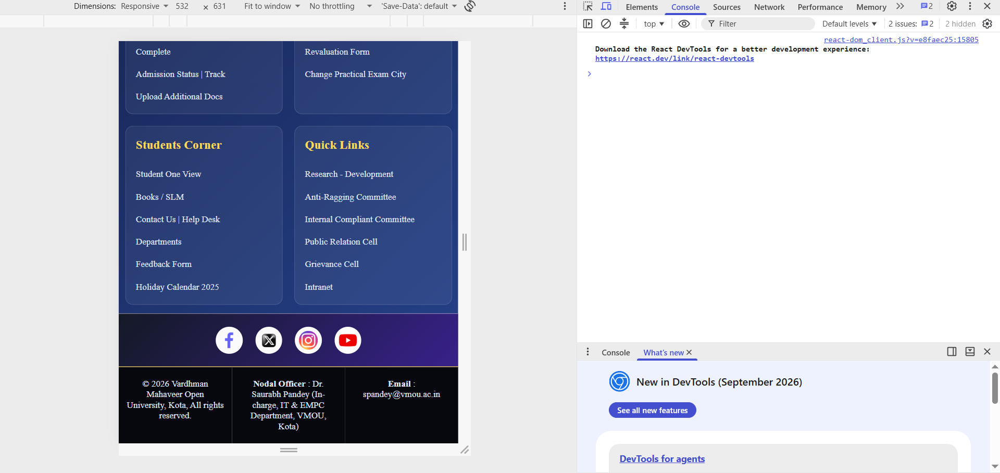
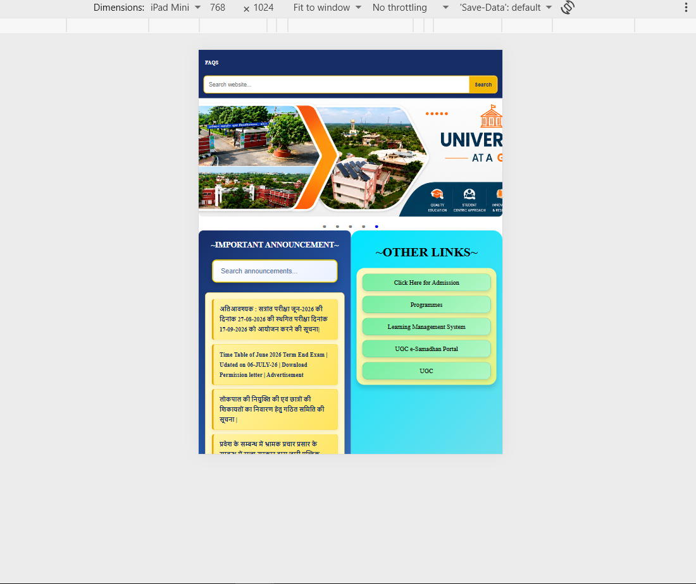
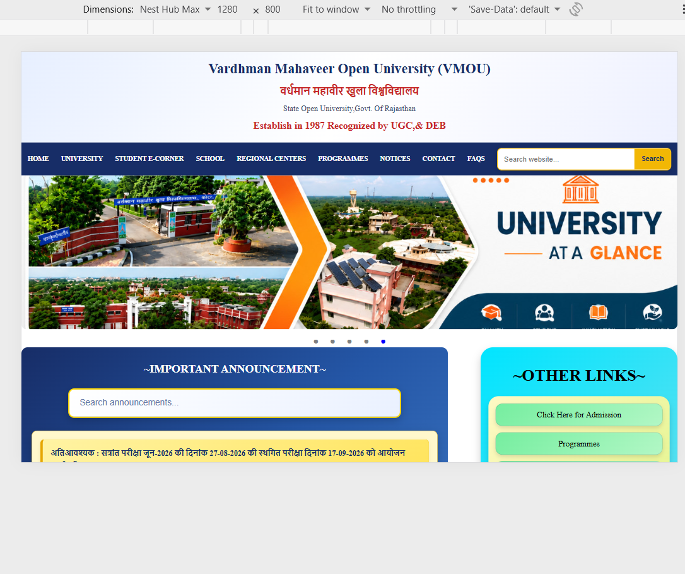
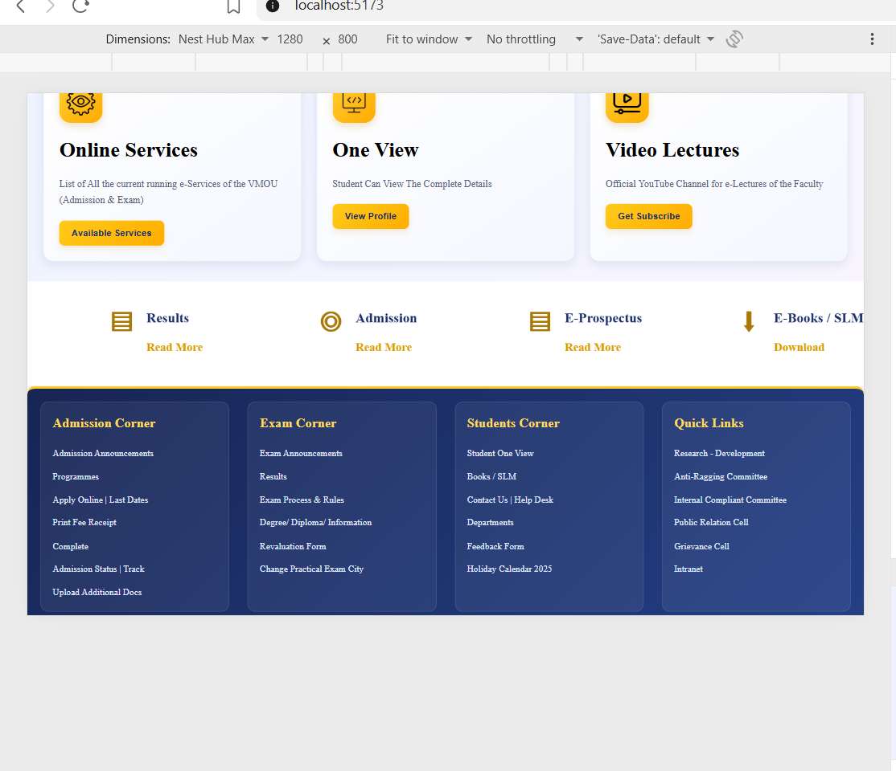

# VMOU-Inspired University Website

## About the Project

This is a responsive university information website developed using React.js as part of a frontend development skills assessment.

The project is inspired by the public-facing structure of Vardhman Mahaveer Open University (VMOU). It provides a simple way for students to explore university information, admission announcements, academic programmes, study materials and student services.

My main focus was on building reusable React components, responsive layouts, working navigation and client-side search while maintaining a clean academic design.

**Note:** This is an independent demo project, not an official VMOU website.

## Features

- Responsive header and navigation menu
- Dropdown menus for university sections
- Client-side search for navigation pages and announcements
- Admission announcements and notices
- Online services and student quick links
- E-Books and study material section
- Departments and academic programmes
- Regional centre information
- Student support and contact section
- Automatically sliding service cards
- Responsive footer
- Data-driven content using JavaScript arrays
- Page navigation using React Router DOM
- Reusable components and separate CSS files
- No backend or database required

## Technologies Used

- React.js
- JavaScript
- HTML5
- CSS3
- React Router DOM
- Vite

## Project Structure

```text
VMOU-Inspired-University-Website/
├── public/
│   └── Images/
├── src/
│   ├── Data/
│   │   ├── Announcement.js
│   │   └── Navigation.js
│   ├── Pages/
│   ├── css/
│   ├── App.jsx
│   └── main.jsx
├── package.json
└── README.md
```

The project is organised into reusable components, JavaScript data files and separate CSS files for easier maintenance.

## Getting Started

### 1. Clone the repository

```bash
git clone https://github.com/mcagovind980/VMOU-Inspired-University-Website.git
```

### 2. Open the project folder

```bash
cd VMOU-Inspired-University-Website
```

### 3. Install dependencies

```bash
npm install
```

### 4. Run the project

```bash
npm run dev
```

Open the local URL displayed in your terminal to view the website.

### 5. Build for production

```bash
npm run build
```

## Assessment Requirements

The project follows the main requirements of the frontend assessment:

- Responsive design for mobile, tablet and desktop screens.
- Reusable components and data-driven rendering.
- Search functionality for available website content.
- Functional navigation and relevant page links.
- Organised project structure and component-specific CSS.
- Clear academic layout, readable colours and consistent styling.
- Empty search results message when no matches are found.

## What I Learned

While developing this project, I practised React component development, React Router navigation, JavaScript array methods, client-side search and responsive CSS.

I also worked on dropdown menus, sliding service cards and fixing layout and navigation issues.

## Future Improvements

- Add category filters for announcements and services.
- Improve search to cover more website content.
- Add a reusable `NoticeCard` component if not already implemented.
- Improve keyboard navigation and accessibility.
- Add loading, empty and error states for future API integration.
- Further improve mobile responsiveness and user experience.

## Future API Integration

Currently, the website uses local JavaScript arrays and does not require a backend or database.

In the future, an API could be connected to fetch notices and service information. Loading, empty-data and error states would help handle different API responses.
## Screenshots

### Desktop View
The website displays the university header, navigation menu, image banner, announcements, quick links, online services and footer in a structured layout.

### Tablet View
The layout adjusts to tablet screen sizes, keeping the main sections readable and accessible.

### Mobile View
The website adapts to smaller screens, with content arranged to support mobile browsing and scrolling.

## Responsive Design

The website is designed to support different screen sizes:

| Device | Tested Viewport |
|---|---|
| Mobile | 532 × 631 |
| Tablet | 768 × 1024 |
| Desktop | 1280 × 800 |

Responsive design is implemented using CSS media queries and flexible layouts where applicable. The goal is to keep navigation, announcements, service cards and footer content usable across devices.

## Screenshots

### Mobile View


### Tablet View


### Desktop View


### Services and Footer



=======


## Live Demo

https://vmou-inspired-university-website.netlify.app

## Source Code

https://github.com/mcagovind980/VMOU-Inspired-University-Website


## Author


=======
## Author

**Govind Kumar**

- GitHub: https://github.com/mcagovind980
- LinkedIn: https://www.linkedin.com/in/govindkumarmern/
